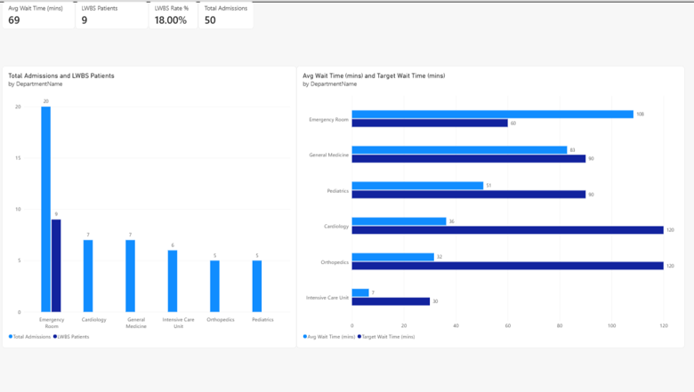
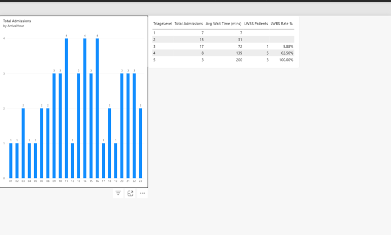
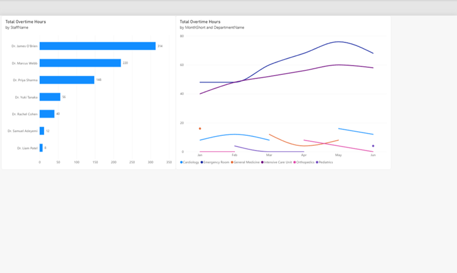
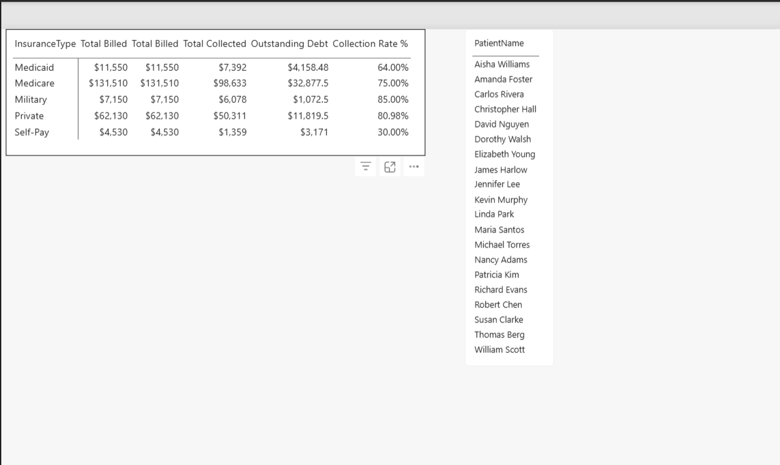
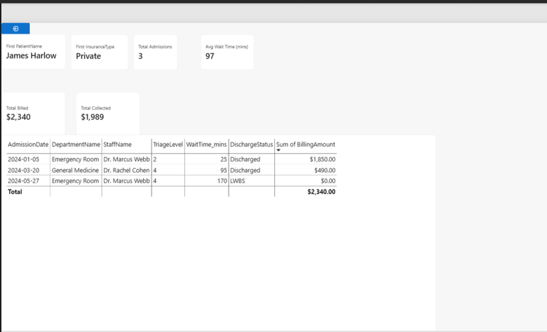

# 🏥 MediCore Hospital Network — Emergency & Operational Intelligence

## 📌 Executive Summary
MediCore Hospital Network is a multi-specialty regional healthcare provider operating emergency trauma, critical care, surgical, and general medical facilities. Recently, executive leadership faced three converging operational crises:
1. **Patient Safety Crisis:** Emergency Room wait times exceeded 108 minutes, driving an alarming **18.00% LWBS (Left Without Being Seen)** rate.
2. **Clinical Burnout Scandal:** Senior physicians submitted resignation notices citing unsustainable clinical workloads and dangerous overtime.
3. **Financial Risk Exposure:** Uninsured self-pay patients generated high charge volumes with a dismal **30.00% net collection recovery rate**.
This project delivers an enterprise-grade **5-Page Analytical System** built in Microsoft Power BI using a **Multi-Fact Constellation Data Warehouse Model** to diagnose operational bottlenecks, quantify clinical staffing deficits, and deliver board-level interventions.
---
## 📸 Dashboard Suite (5 Pages)
### Page 1: Executive Command Center
*Macro-level hospital health, departmental wait time variances, and emergency walkout tracking.*

### Page 2: Patient Flow & Triage Intelligence
*Hourly patient surge distributions (11:00, 14:00, 16:00 peak bottlenecks) and Triage severity correlations (100% walkouts in Level 5).*

### Page 3: Clinical Staffing & Burnout Analysis
*Physician overtime leaderboard exposing Dr. James O'Brien's 314 overtime hours and chronic ICU understaffing.*

### Page 4: Financial Health & Collections Risk
*Payer-mix collection efficiency exposing the 30% collection rate on Self-Pay debt.*

### Page 5: Patient EHR Drill-Through File
*Interactive deep-dive audit tracing individual patient histories, wait times, and discharge outcomes.*

---
## 🏗️ Data Architecture: Dual-Fact Constellation Schema
The semantic model links two independent transactional business processes (`Fact_Admissions` and `Fact_Staffing`) across **four conformed dimensions** with single-direction `1-to-Many (1:*)` relationships:

  
              [Dim_Calendar]
                     │
     ┌───────────────┼───────────────┐
     ▼ (1:*)         ▼ (1:*)         ▼ (1:*)

  

[Dim_Patients]  [Dim_Departments]  [Dim_Staff]
│               │               │
└───────┬───────┴───────┬───────┘
▼               ▼
[Fact_Admissions] [Fact_Staffing]
(50 Inpatient/ER) (36 Shift Logs)


  
---
## 🧮 Core DAX Measures & Formulations
### 1. Left Without Being Seen (LWBS) Risk Metric
```dax
LWBS Patients = 
CALCULATE (
    [Total Admissions],
    Fact_Admissions[DischargeStatus] = "LWBS"
)
LWBS Rate % = 
DIVIDE ( [LWBS Patients], [Total Admissions], 0 )

  
2. Operational Wait Time Variance

  
dax
Target Wait Time (mins) = 
AVERAGE ( Dim_Departments[TargetWaitTime_mins] )
Avg Wait Time (mins) = 
AVERAGE ( Fact_Admissions[WaitTime_mins] )

  
3. Physician Overtime Rate %

  
dax
Total Overtime Hours = SUM ( Fact_Staffing[OvertimeHours] )
Total Hours Worked   = SUM ( Fact_Staffing[HoursWorked] )
Overtime Rate % = 
DIVIDE ( [Total Overtime Hours], [Total Hours Worked], 0 )

  
4. Payer Collection Efficiency

  
dax
Outstanding Debt = [Total Billed] - [Total Collected]
Collection Rate % = 
DIVIDE ( [Total Collected], [Total Billed], 0 )

  

  
💡 Key Clinical & Operational Discoveries

  

  
The ER Bottleneck: All 9 hospital walkouts (100% of hospital LWBS events) occurred exclusively in the Emergency Room, where average wait times reached 108 minutes against a 60-minute target SLA.

  
Triage Misallocation: Critical patients (Triage Levels 1 & 2) experienced excellent turnaround (7–31 mins, 0 walkouts). The ER was paralyzed by Triage Level 4 & 5 non-urgent patients who suffered 139–200 min delays, resulting in a 62.5% to 100% walkout rate.

  
The ICU Burnout Driver: Dr. James O’Brien logged 314 hours of overtime in 6 months (~52 hrs/month), representing the sole intensivist coverage in Critical Care. ER physicians logged an additional 368 combined overtime hours.

  
Payer-Mix Debt Leakage: Insured collections averaged 64% to 85%, while Self-Pay patients yielded only 30.00%, generating severe bad-debt write-offs on non-urgent ER admissions.

  

  

  
🚀 Strategic Recommendations for the Board of Directors

  

  
Establish a Fast-Track Urgent Care Clinic: Divert Triage Level 4 & 5 cases away from emergency trauma bays into a lower-cost clinic staffed by nurse practitioners during peak surge hours (11:00, 14:00, 16:00).

  
Immediate Intensivist Recruitment: Hire a second full-time ICU Senior Physician to eliminate Dr. O'Brien's 50+ monthly overtime hours and prevent clinical turnover.

  
Intake Financial Counseling: Station financial counselors at ER check-in to assess uninsured patients for Medicaid eligibility or prompt-pay cash discounts before discharge.

  

  

  
🛠️ Technology Stack

  

  
Platform: Microsoft Power BI Desktop

  
Modeling: Dual-Fact Constellation Schema, Conformed Dimensions, Bi-directional Conflict Resolution

  
Languages: DAX (Data Analysis Expressions), Power Query M

  
Interactions: Dynamic Drill-Through Filtering, Time-of-Day Surge Heatmapping